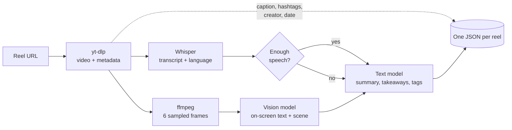

# ScrollSilo

**Turn the reels you save into searchable knowledge, entirely on your own machine.**


## Why ScrollSilo

Saved reels are a black hole. You bookmark a great explainer, and months later you can't find it, can't search what was said in it, and can't remember who made it.

ScrollSilo takes a reel URL and produces one portable JSON record: who posted it, the caption and hashtags, what was said (transcribed and translated), what was shown on screen, a short summary, key takeaways and topic tags. Everything runs on local models, so your saved content never leaves your computer.

> Nothing in a default run calls a cloud AI service. The only network traffic is fetching the reel itself and the one-time download of model weights.

## Features

- **Download public reels** with [yt-dlp](https://github.com/yt-dlp/yt-dlp), no login needed for the reels tested so far.
- **Speech transcription** with language detection, using [MLX Whisper](https://github.com/ml-explore/mlx-examples/tree/main/whisper) on Apple silicon.
- **No-speech guard:** music or noise is reported as `has_speech: false` with an empty transcript, so nothing is invented from the caption.
- **On-screen understanding:** frames are sampled with ffmpeg and read by a local vision model, which picks up text overlays and diagrams.
- **Structured analysis** from a local text model: summary, takeaways, tags and a content type, validated against a schema with automatic retries.
- **Caption and hashtags** captured alongside the creator, handle and post date.
- **One JSON per reel,** including the original reel link, ready to be imported into other tools.

## Quick start

Prerequisites: macOS on Apple silicon, [Homebrew](https://brew.sh), [uv](https://docs.astral.sh/uv/) and [Ollama](https://ollama.com).

```bash
# 1. System tools
brew install ffmpeg yt-dlp

# 2. Local models (about 11 GB, one time)
ollama pull qwen2.5:7b
ollama pull qwen2.5vl:7b

# 3. Install ScrollSilo (from the project directory)
uv sync

# 4. Archive a reel
uv run scrollsilo https://www.instagram.com/reel/<reel-id>/
```

The first run also downloads the Whisper weights (about 1.5 GB). The result is written to `./output/<reel-id>.json`. Downloaded video and frames are kept in `./output/.media/` and can be deleted at any time.

## How it works



All models run through [Ollama](https://ollama.com) (text and vision) and MLX (speech). The text model is asked for JSON that is validated against a schema, and a failed or looping generation is retried at a higher temperature.

## Output

Each run writes one file. See [`examples/sample-output.json`](examples/sample-output.json) for a complete (synthetic) example.

| Field | Meaning |
|---|---|
| `source` | The original reel URL |
| `creator`, `handle` | Display name and Instagram username |
| `posted` | Post date, `YYYY-MM-DD` |
| `caption`, `hashtags` | Full caption, and the `#hashtags` found in it (lowercased, de-duplicated) |
| `has_speech` | `true` only when enough confident speech was heard |
| `language` | Detected spoken language, or `null` when there is no speech |
| `transcript` | Spoken words in the original language; empty without speech |
| `transcript_en` | English translation; empty without speech |
| `summary`, `takeaways` | What the reel conveys, in English |
| `tags` | Up to 8 topic tags |
| `content_type` | One of `tutorial`, `opinion`, `news`, `entertainment`, `promo`, `personal`, `other` |

## Configuration

| Flag | Default | Purpose |
|---|---|---|
| `--out` | `./output` | Where JSON records and media are written |
| `--text-model` | `qwen2.5:7b` | Ollama model for the analysis |
| `--vision-model` | `qwen2.5vl:7b` | Ollama model for frame understanding |
| `--whisper-model` | `mlx-community/whisper-large-v3-turbo` | MLX Whisper model |

## Known limitations

ScrollSilo is an early proof of concept, tested on two reels. Be aware of the following:

- **Mixed-language speech** (for example Hindi with English words) transcribes with some garbled words, and the English translation inherits them.
- **Dense diagrams** can send the vision model into repetitive output. A token cap and retries bound this, but it can still happen and slow a run.
- **Frame notes are not saved** in the JSON yet, and the summary leans on the caption when a reel has no speech, so a visual explainer with a sales-heavy caption can be under-summarised.
- **`content_type` is a single label,** so an educational reel with a promotional caption may be labelled `promo`.
- **Tags are raw model output** (they can contain spaces and capitals) and are not yet normalised for tools like Obsidian.
- **Instagram can block or rate-limit downloads** or ask for a login at any time. Only public reels have been tried.
- **Apple silicon only** for now, because the speech backend is MLX.

## Roadmap

| Area | Planned |
|---|---|
| Knowledge extraction | Save frame notes, rank transcript and on-screen content above the caption, separate `has_promo` from `content_type` |
| Obsidian | Export to notes with normalised kebab-case tags and frontmatter for tag and Dataview queries |
| Ingest | Batch files and saved collections, with de-duplication and resumable runs |
| Portability | A Whisper backend for Linux and Windows |
| Interfaces | MCP server and a small local web page |

## Troubleshooting

- **`ollama pull` seems to do nothing:** pull through the HTTP API instead, for example `curl localhost:11434/api/pull -d '{"model":"qwen2.5:7b"}'`, and check `ollama list` afterwards.
- **A run hangs in the vision step:** stop it and run again; retries use a higher temperature.

## Contributing

Issues and pull requests are welcome. See [CONTRIBUTING.md](CONTRIBUTING.md) for setup and the checks to run.

## Disclaimer

ScrollSilo is for personal use. Respect Instagram's terms of service and the rights of the people who made the content. Do not redistribute downloaded media. No media is stored in this repository.

## License

[MIT](LICENSE)

## Acknowledgements

Built on [yt-dlp](https://github.com/yt-dlp/yt-dlp), [MLX Whisper](https://github.com/ml-explore/mlx-examples), [Ollama](https://ollama.com), [Qwen](https://github.com/QwenLM) models and [Pydantic](https://docs.pydantic.dev).